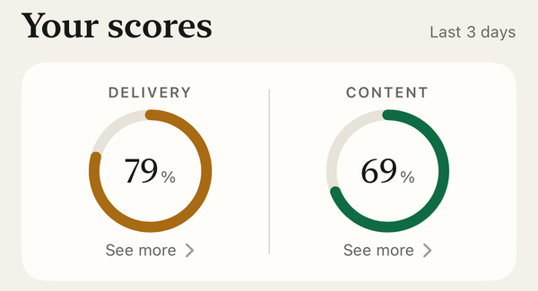
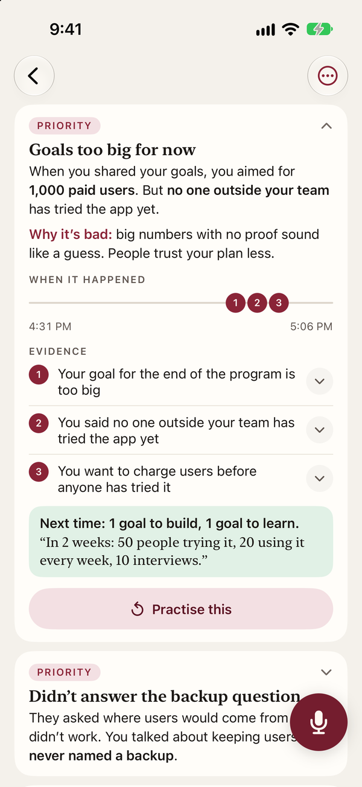
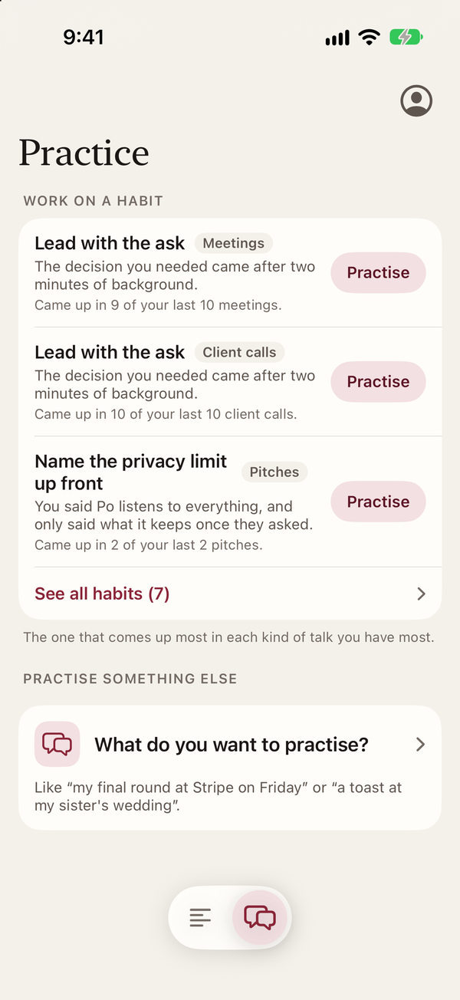

# Core Concepts

Part 1 · Conceptual Overview · For: anyone new to Po

Po evaluates communication through two main dimensions: Delivery and Content. This page explains both, how Po scores them, and how Po turns its feedback into personalized improvement.

## Delivery: How You Sound

Delivery focuses on vocal characteristics such as speaking pace, pauses, tone, word stress, rhythm, and filler words. These measurements help users understand how their speaking habits may affect the clarity of their message.

## Content: What You Say

Content focuses on how effectively someone communicates their ideas in a particular situation. For example, an interview answer may be more effective when it clearly explains the results of someone's work. During a meeting, presenting the main point earlier may help others understand a suggestion. Po evaluates Content based on the conversation's purpose and the communication issues identified by its AI coach. It is not designed to score grammar or word choice.

## Kinds of Conversations

Because good communication looks different in different situations, Po works out what kind of conversation each one was, such as a meeting, a client call, a pitch, an interview, a presentation, networking, a speech, or an everyday talk. Users don't need to choose; Po decides on its own.

## Scores

Po reports Delivery and Content on a scale from 0 to 100, based on the user's last 10 conversations, so users can understand how their speaking changes over time. A score is intended to highlight opportunities for improvement, not to define someone's language ability.

Both scores appear as rings on Po's main page. Tapping a score shows what is behind it: for Delivery, which elements are in a comfortable range; for Content, how the user does in each kind of conversation.

## From Feedback to Personalized Improvement

Po's coaching focuses on specific moments from real conversations. A suggestion can include a quote, an explanation of why the moment matters, and an alternative way to communicate the idea. For example, someone might explain a project during an interview without describing its outcome. Po may highlight that response and suggest stating the result more clearly. Users can review the transcript, listen to the corresponding recording, and try saying the suggested response.

### Coaching Cards

Po presents each suggestion as a **coaching card**, listed under **Work on these** on a conversation's page, with the most important first. Each card has a label that shows how urgent it is:

- **PRIORITY:** the most important thing to work on in this conversation.
- **WORTH A LOOK:** worth improving, but less urgent.

When a user opens a card, it shows why the moment matters, when it happened, the user's own words, and a **Next time** suggestion with an example of what to say.

### Habits

Po builds on this feedback through **habits**. Habits are communication problems that appear repeatedly across different conversations. Rather than treating one difficult conversation as an ongoing problem, Po is designed to look for patterns over time.

Po keeps a separate list of habits for each kind of conversation, because a habit that matters in interviews may not matter in casual chats. Each list shows what the user does well and what they can improve. When a user stops repeating a habit, Po marks it as fixed and keeps listening in case it comes back.

### Practice

Feedback helps most when users can try again before the next real conversation. **Practice** lets users rehearse out loud with Po, for example before a job interview, a pitch, or a toast at a wedding. Po plays the other person, listens to the user's answers, and gives feedback afterwards.

Po offers three ways to practice:

| Way to practice | What happens | Feedback |
|---|---|---|
| **Talk it through** | Po plays the other person, such as an interviewer or a client, and has a spoken conversation with the user. | After the practice, Po coaches it like any recorded conversation. |
| **Your questions again** | Po asks questions the user was really asked in a past conversation, so they can answer them better this time. | After each answer, Po checks it and shows how it compares with the first time. |
| **New questions** | Po writes new questions for the situation the user is preparing for. | After each answer, Po checks it and suggests what to try on the next attempt. |

Users don't need to choose; Po picks the way that fits, and users can change it. There are three ways to start a practice:

- **From the Practice page**, by telling Po what is coming up, such as "my final interview on Friday." Po asks a few questions, then makes a short plan.
- **From a habit**, to work on something that keeps coming up in one kind of conversation.
- **From a coaching card**, to try a specific moment again with **Practise this**.

Every practice is saved with the user's other conversations, so they can listen back and see how they did. Practice needs an internet connection and the microphone, and Po allows a few practices each day.

---

**Next:** [Main Parts of Po](concept-parts-of-po.md)
