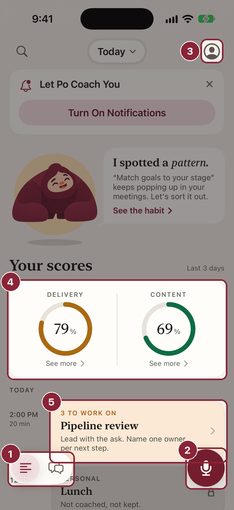
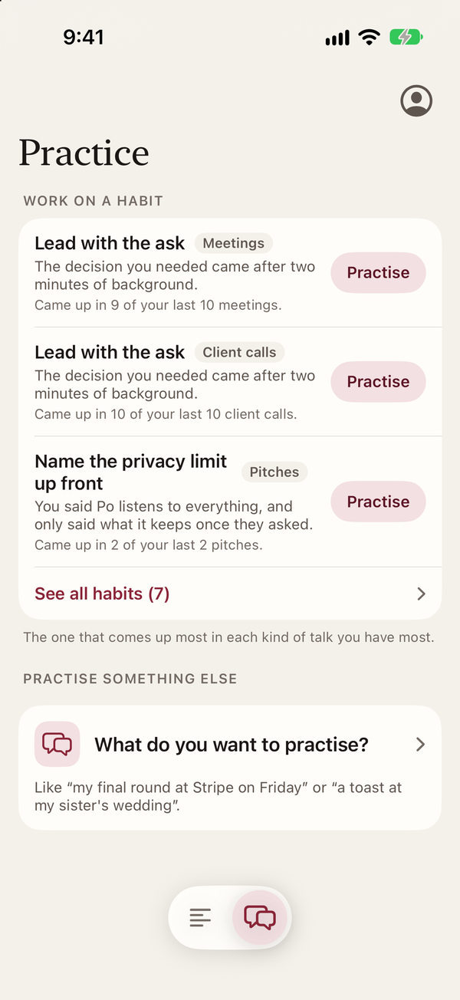

# Main Parts of Po

Part 1 · Conceptual Overview · For: anyone new to Po

Po organizes its main features into two main pages, **Talks** and **Practice**, a page for each conversation, and a separate settings area called **You**. Users switch between Talks and Practice by swiping sideways or by tapping the small two-icon switch at the bottom left of the screen.

In the picture: **(1)** the switch between Talks and Practice, **(2)** the Record button, **(3)** the button that opens **You**, **(4)** the scores, which open the Score pages, and **(5)** a conversation, which opens its Conversation page.

## Talks

**Talks** is the application's home screen. It displays recent speaking scores, daily insights from Po's mascot, which communicates through a speech bubble, and every recorded conversation, grouped by day. A colored label on each conversation shows whether it has something important to work on.

## Practice

**Practice** is where users rehearse for upcoming conversations. It shows the habits Po suggests working on, a box for telling Po what to practice, and the user's past practices.

## Record Button

The **Record button** is the round button with a microphone at the bottom right of the Talks page. Users tap it to start recording and slide it to stop.

## Conversation Pages

**Conversation pages** store individual conversations, including audio recordings, transcripts, speaking measurements, and personalized coaching feedback. Users can revisit their conversations to better understand their speaking habits.

## Score Pages

**Score pages** open when users tap a score on the Talks page. They show what is behind each score, recurring speaking habits identified by Po, and habits that have been fixed.

## You

Users can also access a separate **You** area, from the person icon at the top of the page, to manage their account, voice sample, notifications, and privacy controls.

## Lock Screen

Users can also start and stop a recording from the iPhone's Lock Screen without opening Po.

---

**Next:** [Privacy and Consent](concept-privacy-and-consent.md)
