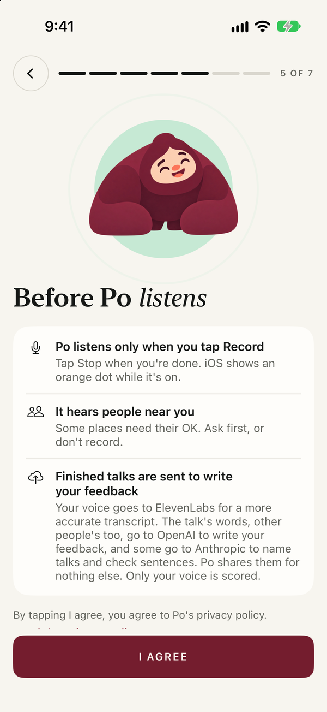

# Privacy and Consent

Part 1 · Conceptual Overview · For: anyone new to Po, before the first recording

Po stores voice recognition data and some speech analysis on the iPhone. Users can control recording by choosing when to start and stop, muting a recording, and changing their privacy settings. For personalized coaching, Po sends conversation text to external AI services. The user's own voice may also be sent to an external transcription service when **More accurate words** is turned on. Since other people's voices may be recorded, users should obtain any consent required before recording conversations.

## Asking for Consent

Consent means a person's permission, given before you record them. When someone records a meeting or a call, Po hears everyone nearby, not only the user. Po gives feedback only on the user's voice, but it still hears the others.

!> In some places, recording people without telling them is against the law. In the United States, this includes California, Illinois, and Washington. **Ask before you record. If you can't ask, don't record.**

Po shows this same advice during setup, on the **Before Po listens** page.

Asking can be simple. Po suggests saying:

> "I'm recording to coach my speaking. Tell me if you'd rather not."

## What Stays on the iPhone

- **The voice print**, a description of how the user's voice sounds, made from the voice sample in setup. It is a list of numbers, not a recording, and it is never sent anywhere.
- **Recordings**, until the user deletes them or chooses a time for Po to delete them automatically. Other people's voices in a recording are silenced after one day.
- **Transcripts**, the written words of each conversation.

## What Leaves the iPhone

- **The words of each conversation**, including other people's words, go to Po's server and to an AI service (OpenAI), which writes the feedback. The user's own words also go to a second AI service (Anthropic), which names and organizes conversations.
- **The user's own voice** goes to Po's server and a transcription service (ElevenLabs) for a more accurate transcript, only while **More accurate words** is on. Other people's voices are silenced before it is sent.
- **For practice**, Po sends what the user types, short summaries of their past conversations, their habits, and upcoming calendar events, so it can plan a realistic practice. Po may also look things up online.
- **How the user uses the app**, including recordings of Po's screens with other people's lines blacked out, goes to an analytics service to help improve Po. Users can turn this off with **Share how you use Po**.

## What Po Remembers About the User

After a practice, Po may save short facts it heard, such as the user's job role or an upcoming interview, so the next practice feels more realistic. Users can see, change, or delete these facts on the **What Po knows about you** page.

## Privacy Choices

Users can:

- **Delete a conversation**, or **mark it as personal**, which deletes it from the phone and keeps it out of their feedback
- **Delete other people's words** from a conversation while keeping their own
- **Mute recordings at night**, in case they forget to stop recording
- **Choose how long recordings are kept**, or delete all recordings at once
- **Delete a practice**, or the facts Po remembers
- **Delete everything** on the phone, or **delete their account**

The task [Keeping a Talk Private](task-keep-talks-private.md) shows the steps for each choice.

---

**Next:** You have finished Part 1. Go to the [Overview of Tasks](task-index.md).
