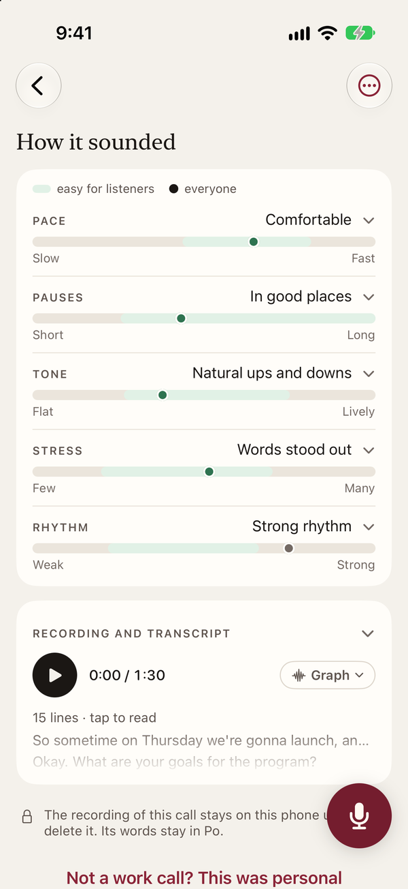

# Understanding the Elements of Spoken Communication

Part 1 · Conceptual Overview · For: anyone new to Po

Effective communication involves more than choosing the right words. The way someone speaks can influence how easily listeners understand a message. Po analyzes several characteristics of spoken communication to help users recognize their speaking patterns.

## Timing

These elements describe how speech moves through time.

### Speaking Pace

Speaking pace describes how quickly or slowly someone speaks. Speaking too quickly can make complex ideas difficult to follow, while speaking too slowly may interrupt the natural flow of a conversation.
### Pauses

Pauses are brief periods of silence between words or ideas. Pauses give listeners time to process information and help speakers organize their thoughts. However, pausing too frequently or not enough may affect the clarity of a message.
## The Voice

These elements describe the sound of the voice itself.

### Pitch

Pitch describes how high or low a person's voice sounds. Everyone has a natural vocal range, and having a higher or lower voice is not inherently better. Po focuses on changes in pitch rather than a person's natural vocal pitch.
### Intonation

Intonation refers to how pitch rises and falls during speech. Changes in intonation can help listeners distinguish questions from statements, recognize emphasis, and understand a speaker's intended meaning. Po shows pitch and intonation together as **Tone**: whether the voice moves naturally or stays on one note.
### Word Stress

Word stress refers to emphasizing certain words to communicate meaning. For example, in the sentence "I wanted the BLUE one," emphasizing "blue" highlights which color the speaker wanted. Po examines whether speakers emphasize important words in their sentences.
### Volume

Volume describes how loudly or softly someone speaks. Speaking too softly or allowing the end of a sentence to fade may make information harder to hear. Po measures volume but does not score it, because loudness depends mostly on how far the phone is from the speaker.
## Flow

These elements describe how smoothly speech continues from one idea to the next.

### Rhythm

Rhythm refers to the timing and flow of speech. Different languages and accents have different rhythmic patterns. Po checks whether important words stand out from small words like "the" or "to," and accepts many natural rhythms, since there is no single correct rhythm for everyone.
### Filler Words

Filler words are words or sounds such as "um," "uh," and "like" that speakers sometimes use while thinking. Occasional filler words are normal, but frequent use may interrupt the flow of a conversation.
### Hesitations

Hesitations are longer pauses that occur when someone struggles to find words or organize their thoughts. While occasional hesitations are natural, frequent hesitations may make a message harder to follow. Po does not list hesitations separately; they show up in a user's pauses and filler words.

## Why These Elements Matter

Po uses these elements to identify speaking patterns that may affect communication. Rather than expecting everyone to speak perfectly or sound the same, Po focuses on helping users recognize habits and communicate more clearly.

## Where These Elements Appear in Po

After each conversation, Po shows five of these elements as simple bars under **How it sounded**: **Pace**, **Pauses**, **Tone**, **Stress**, and **Rhythm**. Each bar has a shaded area that is easy for listeners and a dot that marks where the user is. Filler words appear as their own feedback card when they come up often.

---

**Next:** [Core Concepts](concept-core-concepts.md)
