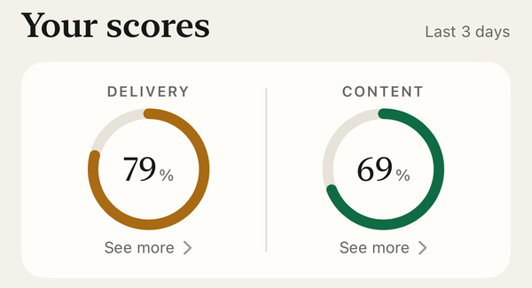
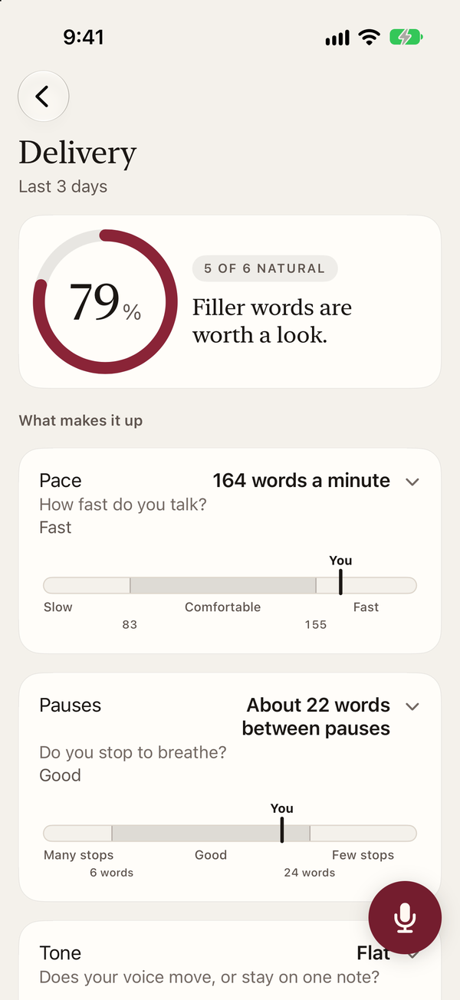
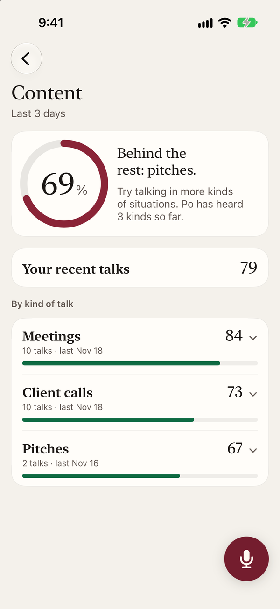

# Checking Your Scores Over Time

Part 2 · Task Documentation · For: Po users with several recorded talks

One talk shows you one moment. Your scores and habits show your patterns. This task shows you how to read your Delivery and Content scores, find the measure that pulls your score down, and see your habits for each kind of talk.

## Before You Start

You need:

- At least one recorded talk. Scores are most useful after about 10 talks.
- To know what the scores mean. See [Core Concepts](concept-core-concepts.md).

## To See Your Two Scores

1. Open Po. On the main page, find **Your scores**, under Po's speech bubble.
2. Read the two rings. **DELIVERY** is how you sound and **CONTENT** is what you say, each from 0 to 100. The note on the right, such as **Last 10 talks**, tells you which talks they are based on.

   

   Before your first talk, a ring shows a note such as "After your first talk" instead of a number.

## To Find What Affects Your Delivery Score

1. Under the **DELIVERY** ring, tap **See more**. The Delivery page opens with a summary, such as "5 OF 6 NATURAL," and a headline that names the measure to work on, for example "Filler words are worth a look."

   

2. Scroll through **What makes it up**. Each row shows one measure, the question it answers, your value, and where you fall on the bar.
3. Find the row whose marker sits outside the comfortable middle zone. That is the measure to work on first.
4. Optional: If you have recorded more than one kind of talk, tap a row to see that measure for each kind.
5. To go back, tap the **‹** button at the top left.

## To See Your Content Score by Kind of Talk

1. On the main page, under the **CONTENT** ring, tap **See more**. The Content page opens with a headline, such as "Behind the rest: pitches."

   

2. Under **By kind of talk**, compare your scores. Each row shows the number of talks, when the last one was, and the score.
3. Find the kind with the lowest score. That is where coaching will help you most.

## To See Your Habits for One Kind of Talk

1. On the Content page, tap a kind of talk, such as **Meetings**. The row opens to show **WHAT YOU DID WELL** and **WHAT YOU CAN IMPROVE**.
2. Tap a habit under **WHAT YOU CAN IMPROVE**. The habit's page opens. It explains why it matters, shows evidence from your talks, and suggests what to try.
3. Optional: Tap a piece of evidence to open the talk at that moment.
4. If the habit is wrong, tap **This isn't right**, then tap **Take it off**. Po won't raise it again for that kind of talk.

## To Find a Talk from Another Day

1. At the top of the main page, tap the date, for example **Today**. The **Your days** calendar opens. Each day is colored: **Better**, **Worth a look**, or **About usual**.
2. Tap a day. The list scrolls to that day's talks.

To find a talk by name or topic instead, tap the magnifying glass at the top left and type a word, such as "interview."

## Result

You know your two scores, the delivery measure to work on first, and the kind of talk where you have the most room to grow.
