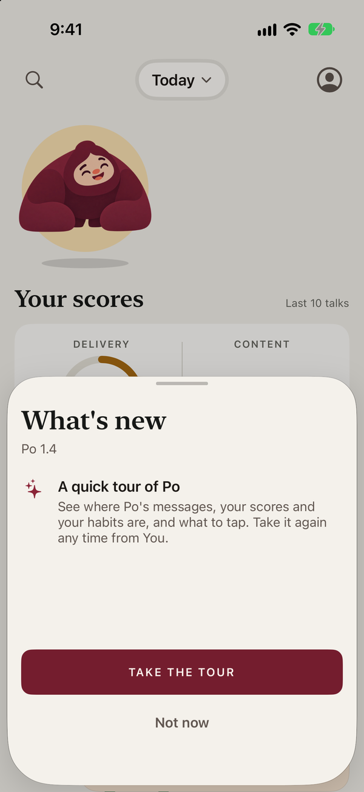

# Installing Po from TestFlight

Part 2 · Task Documentation · For: new Po users

Po is in beta, so you install it through **TestFlight**, Apple's app for testing new apps, instead of the App Store. This task takes about 3 minutes.

## Before You Start

You need:

- An iPhone with iOS 26 or later
- An Apple Account signed in on the iPhone
- An internet connection
- The Po beta link, or access to [www.pospeech.com](https://www.pospeech.com) on your iPhone

## To Install TestFlight

1. On your iPhone, open the **App Store**.
2. Search for **TestFlight**.
3. Tap **Get** next to TestFlight, the app made by Apple. The TestFlight icon appears on your Home Screen.

   If TestFlight shows **Open** instead of **Get**, it is already installed. Go to the next section.

## To Install Po

1. On your iPhone, open the Po beta link you received. If you don't have a link, go to [www.pospeech.com](https://www.pospeech.com) in Safari and tap the download button. TestFlight opens to Po's beta page.
2. Tap **Accept** to join the Po beta.
3. Tap **Install**. The Po app downloads. When it's done, the button changes to **Open**.
4. Tap **Open**, or tap the **Po Speech** icon on your Home Screen.

   

   Po opens to its welcome page, which says "A speech coach for your whole day." A small orange dot next to the app's name on your Home Screen shows that it is a beta app.

## When a New Version of Po Is Available

TestFlight sends you a notification when a new version of Po is ready. To update, open **TestFlight**, then tap **Update** next to Po. After an update, Po may show a **What's new** note the first time you open it.

- Tap **TAKE THE TOUR** to see a short tour of the main page, or **Not now** to close the note.

## If Something Goes Wrong

| Problem | What to do |
|---|---|
| The link says the beta is full or not accepting testers | The beta has a limit on testers. Contact the Po team for a new link. |
| TestFlight says "This beta has expired" | Each beta version expires after 90 days. Open TestFlight and install the newest version. |
| Po isn't on your Home Screen after installing | Swipe down on the Home Screen and search for **Po Speech**. |

---

**Next:** [Set up Po](task-set-up-po.md) to create your account and teach Po your voice.
