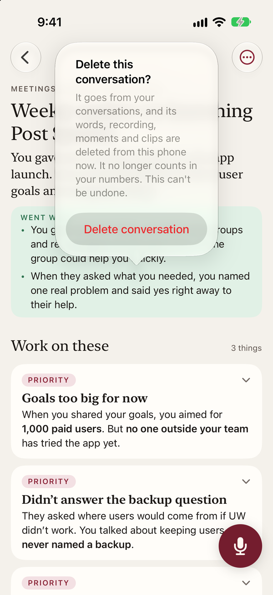
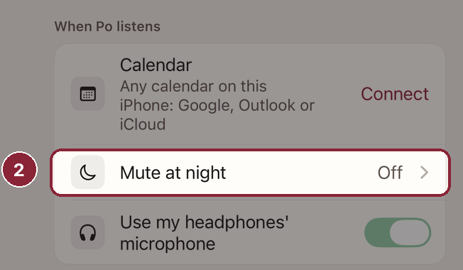
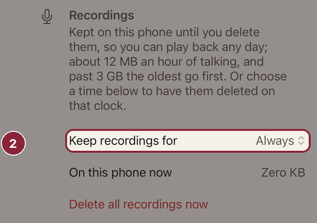
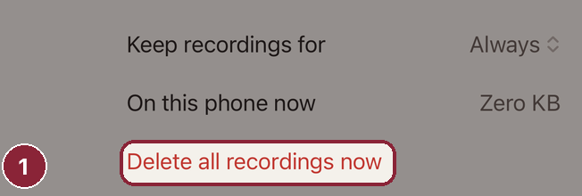

# Keeping a Talk Private

Part 2 · Task Documentation · For: Po users

Sometimes you record something you didn't mean to keep, such as a personal call, or a talk that includes someone who didn't agree to be recorded. This task shows each way to remove a talk or limit what Po keeps, from the smallest change to the largest.

## Before You Start

You need:

- Po set up on your iPhone.
- To know what Po keeps and sends. See [Privacy and Consent](concept-privacy-and-consent.md).

!> Every deletion on this page is permanent. Po can't bring back a deleted recording or talk.

## Removing One Conversation

### To Delete a Conversation

Deleting a conversation removes it from your Talks page, deletes its words, recording, moments, and clips from your iPhone, and removes it from your scores.

1. On the Talks page, touch and hold the conversation. A menu appears. You can also open the conversation and tap the **⋯** button at the top right.
2. Tap **Delete conversation**. Po asks "Delete this conversation?"

   

3. Tap **Delete conversation** to confirm, or **Cancel** to keep it. The conversation disappears from the list.

To delete a practice, see [Practicing for an Upcoming Talk](task-practice.md).

### To Mark One Talk as Personal

Marking a talk as personal deletes its words, recording, moments, and clips from your iPhone, and removes it from your scores. Po doesn't coach it.

1. On the main page, touch and hold the talk you want to remove. A menu appears.
2. Tap **This was personal**. Po asks "Delete it as personal?" and explains what will be deleted.

3. Tap **This was personal** to confirm, or **Cancel** to keep the talk. The talk stays in the list as a grey **PERSONAL** row that says "Not coached, not kept."

You can also mark a talk as personal from its own page: tap the **⋯** button at the top right, or scroll to the bottom and tap **Not a work call? This was personal**.

?> Po's notes on a personal talk may stay on Po's server, which can't delete one conversation yet. Po tells you when this applies in the confirmation message.

### To Delete Other People's Words from One Talk

Use this when you want to keep your own feedback but remove what others said.

1. Open the talk.
2. Tap the **⋯** button at the top right, then tap **Delete their words, keep mine**. You can also find this button under **Who said what** in the transcript. Po asks "Delete other people's words?"
3. Tap **Delete their words, keep mine** again to confirm. Their lines leave the transcript, and their voices leave the recording on your iPhone. Your own words, Po's feedback, and your numbers stay.

## Limiting What Po Keeps

### To Mute Recordings at Night

**Mute at night** protects you if you forget to stop a recording in the evening. A recording still going when night starts mutes itself and unmutes in the morning. It is off until you turn it on.

1. On the main page, tap the person icon at the top right. The You page opens.

   

2. Under **When Po listens**, tap **Mute at night** **(2)**. The **Mute at night** settings open.
3. Turn on **Mute recordings at night**.
4. Set **From** and **To** to your night hours. The default is 10:00 PM to 7:00 AM. The **Mute at night** row now shows your hours instead of **Off**.

Mute at night doesn't stop you from starting a new recording at night.

### To Choose How Long Recordings Stay

By default, Po keeps recordings on your iPhone until you delete them. You can have Po delete them automatically instead.

1. On the You page, under **Privacy**, tap **What Po saves**.

   

2. Under **Recordings**, tap **Keep recordings for** **(2)**, then choose a time: 6 hours, 12 hours, 24 hours, 2 days, 3 days, or Always. Po deletes each recording when its time is up. The words and feedback stay.

### To Stop Sending Audio Off Your iPhone

1. On the **What Po saves** page, scroll to **Words**.
2. Turn off **More accurate words**. Po now uses your iPhone's own transcript, and no audio leaves your phone. Your talks' words are still sent so Po can write feedback.

### To Delete All Recordings

1. On the **What Po saves** page, under **Recordings**, tap **Delete all recordings now** **(1)**.

   

   Po asks "Delete every recording on this phone?"
2. Tap **Delete all recordings** to confirm. All audio is deleted. Your talks' words, feedback, and scores stay.

## Deleting Everything

You can delete everything Po keeps on this iPhone, or delete your account as well.

| You want to | Do this | Result |
|---|---|---|
| Delete everything on this iPhone, but keep your account | On the You page, under **Account**, tap **Delete everything**, then **Delete everything and sign out**. | Every recording, word, talk, clip, and your voice print are deleted. Po signs you out. |
| Delete your account and its data on Po's server | On the You page, under **Account**, tap **Delete account**. Optionally choose a reason, then tap **Delete account** to confirm. | Your account, its server data, and everything on this iPhone are deleted. |

## Result

The talk, the other people's words, or the recordings you chose are deleted, and Po keeps only what you allowed.
