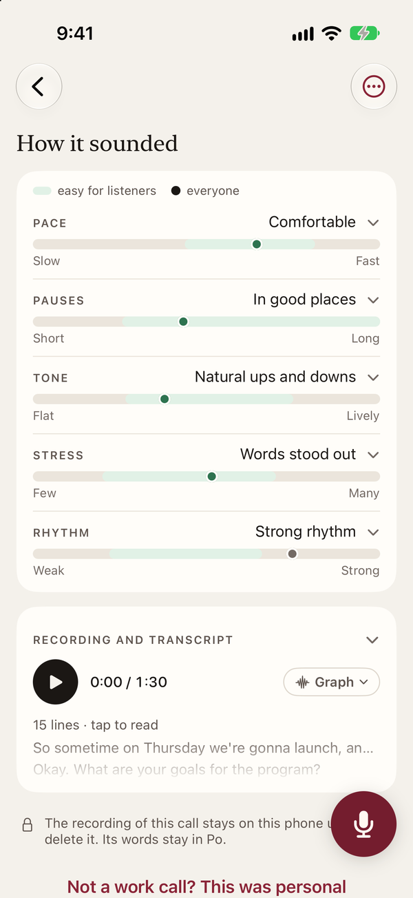
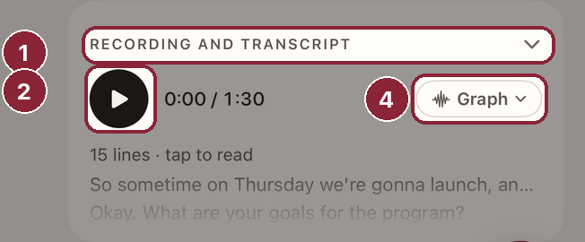
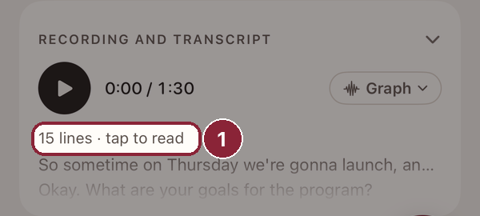
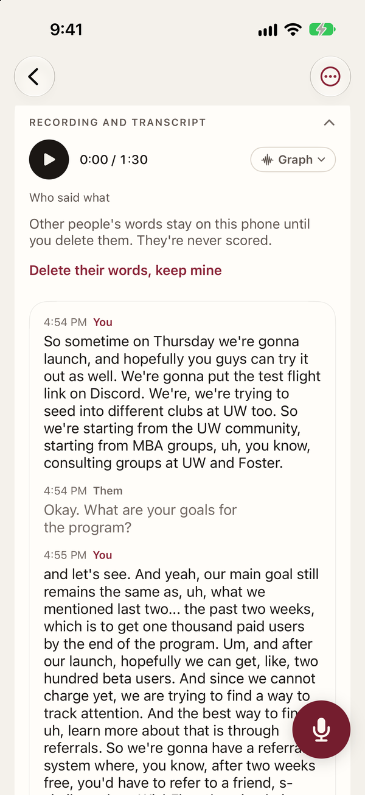

# Listening Back and Reading the Transcript

Part 2 · Task Documentation · For: Po users

Besides coaching cards, every talk you record on your iPhone has two more sections: **How it sounded**, which measures your voice, and **Recording and transcript**, which lets you replay the whole talk and read every word. This task shows how to use both.

## Before You Start

You need:

- A talk recorded on this iPhone.
- To know the six delivery measures. See [Understanding the Elements of Spoken Communication](concept-speaking-elements.md).

## To Check How You Sounded

1. Open a talk from the main page.
2. Scroll down past the coaching cards to **How it sounded**. Five bars show your **PACE**, **PAUSES**, **TONE**, **STRESS**, and **RHYTHM**. The shaded part of each bar is easy for listeners, and the dot is you. The words on the right, such as **Comfortable** or **In good places**, sum up each one.

   

   If the section says "Measuring pace, pauses, pitch and loudness on this phone," wait a few seconds for the bars to appear.

3. Tap a bar to see its details. For example, the **PACE** bar opens to show your exact words per minute, the comfortable range, and a chart of how your speed changed during the talk.
4. Optional: In a chart, tap the line to hear that moment of the talk.
5. Tap the bar again to close it.

If the section says "There was too little talking here to say anything about pace or pitch habits," the talk was too short to measure. You can still play it back.

## To Play the Whole Talk

1. Scroll to the card labeled **RECORDING AND TRANSCRIPT** **(1)**.

   

2. Tap the play button **(2)**. The talk plays from the beginning, the time counts up (for example, **0:12 / 1:30**), and a line of captions shows the words as they are spoken.
3. Tap the button again to pause.
4. Optional: To see your voice as a picture, tap **Graph** **(4)**. The graph shows your pitch, your loudness, and your pauses over time. Tap any point on the graph to jump there, and pinch to zoom in. Tap **Hide the graph** to close it.

## To Read the Transcript

A *transcript* is the written version of everything said in the talk.

1. In the **RECORDING AND TRANSCRIPT** card, tap the line that says how many lines there are, such as **15 lines · tap to read** **(1)**.

   

   The full transcript opens under **Who said what**.

   

2. Read the lines. Each line shows when it was said and who said it: **You**, **Them**, or a label such as **Voice A** when Po can't tell who it was.
3. Optional: To copy words, touch and hold a line, then select the text.
4. If the talk has more than 40 lines, tap the button at the bottom that shows the total, such as **Show all 52 lines**, to see the rest.

?> Under **Who said what**, Po reminds you that other people's words and voices stay on your iPhone until you delete them, and that they are never scored. To remove them, see [Keeping a Talk Private](task-keep-talks-private.md).

## Result

You have heard how you sounded and read exactly what was said, so you can connect Po's feedback to the real conversation.

---

**Next:** [Check your scores over time](task-check-your-scores.md).
