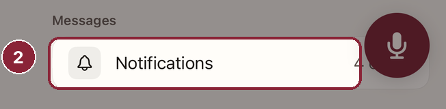
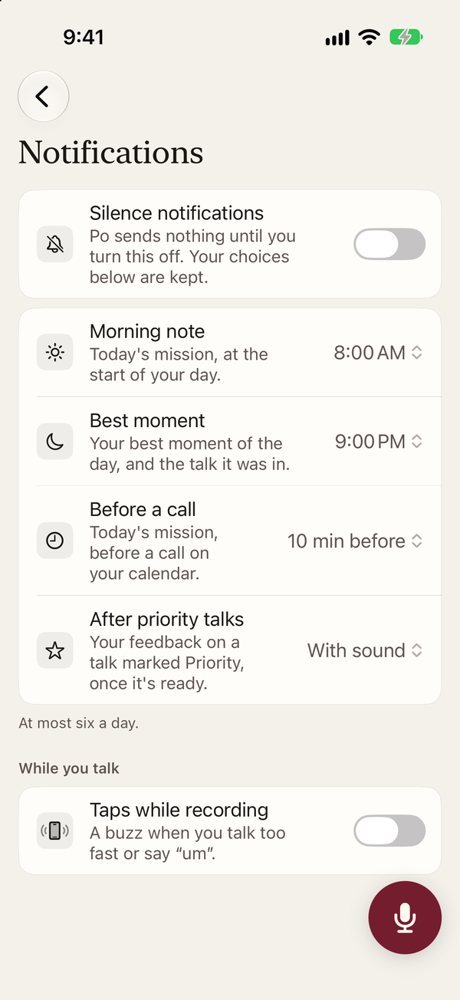

# Choosing Your Notifications

Part 2 · Task Documentation · For: Po users

Po can tell you when your feedback on an important talk is ready, remind you before a call, and share your best moment of the day. Po sends at most six notifications a day and never during a recording. This task shows how to turn notifications on and choose which ones you get.

## Before You Start

You need:

- Po set up on your iPhone.

## To Turn On Notifications

If you tapped **Don't Allow** during setup, a **Let Po Coach You** card appears at the top of the main page.

1. On the main page, tap **Turn On Notifications**.
   - If iOS asks whether Po Speech can send notifications, tap **Allow**.
   - If Settings opens instead, tap **Notifications**, turn on **Allow Notifications**, then return to Po.

   The **Let Po Coach You** card disappears.

## To Choose Which Notifications You Get

1. On the main page, tap the person icon at the top right. The You page opens.
2. Under **Messages**, tap **Notifications** **(2)**.

   

   The **Notifications** page opens.

   

3. For each notification, tap the value on the right and choose a time or **Off**:

| Notification | What it tells you | Choices | Default |
|---|---|---|---|
| **Morning note** | One thing to focus on today | Off, or a time from 5 AM to 11 AM | 8:00 AM |
| **Best moment** | Your best moment of the day, and the talk it was in | Off, or a time from 5 PM to 11 PM | 9:00 PM |
| **Before a call** | A reminder to record, before a call on your calendar (needs your calendar connected) | Off, or 5, 10, 15, or 30 min before | 10 min before |
| **After priority talks** | That your feedback on a PRIORITY talk is ready | With sound, No sound, or Off | With sound |

Your choices are saved as soon as you make them.

## To Pause All Notifications

1. On the **Notifications** page, turn on **Silence notifications**. Po sends nothing until you turn it off. Your other choices are kept for later.

## To Get a Buzz While You Talk (Optional)

**Taps while recording** makes your iPhone buzz when you talk too fast or say "um," so you notice in the moment. It is off by default, and it works only while Po is open on your screen.

1. On the **Notifications** page, under **While you talk**, turn on **Taps while recording**.

## Result

Po sends only the notifications you chose, at the times you chose.
