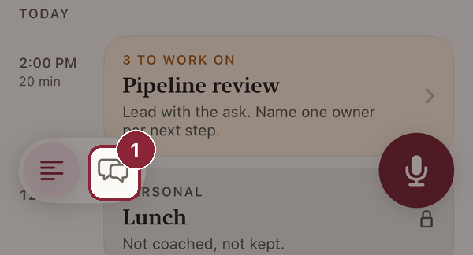
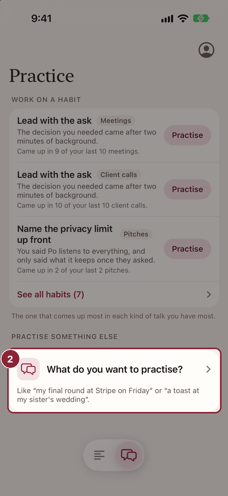
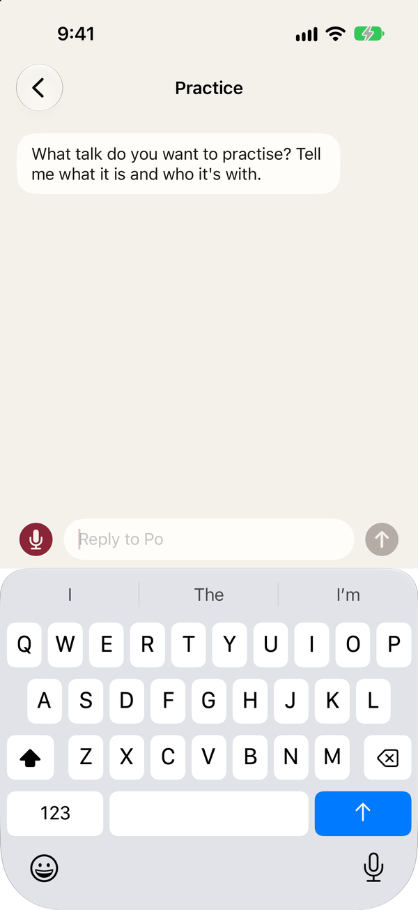
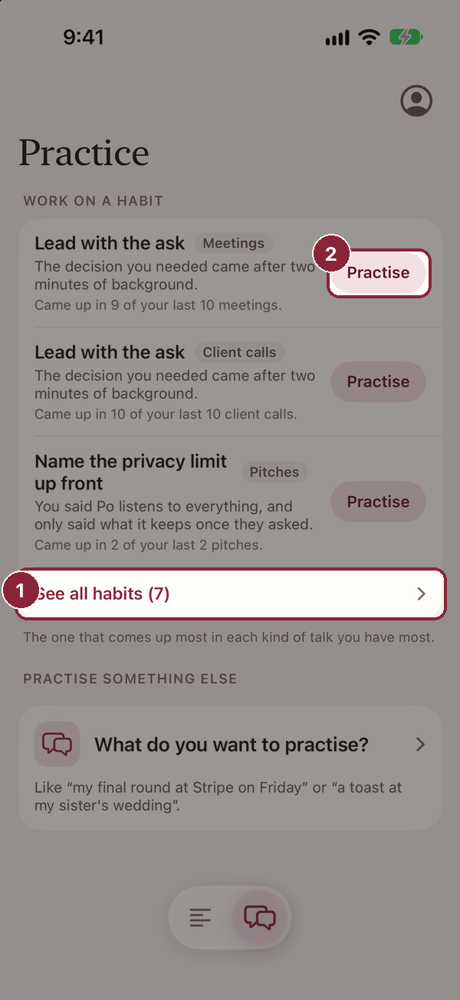
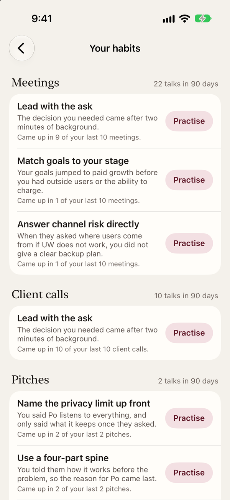
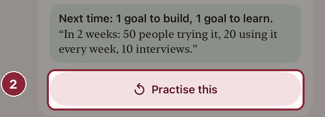

# Practicing for an Upcoming Talk

Part 2 · Task Documentation · For: Po users

Practice lets you rehearse out loud before a real conversation, such as a job interview, a pitch, or a presentation. Po plays the other person or asks you questions, then gives you feedback. A practice usually takes 5 to 15 minutes.

## Before You Start

You need:

- Po set up on your iPhone. See [Setting Up Po](task-set-up-po.md).
- An internet connection.
- A place where you can talk out loud.
- To know the three ways to practice. See [Core Concepts](concept-core-concepts.md).

?> Po allows a few practices each day. If you reach the limit, Po tells you, and you can practice again the next day.

## Starting a Practice

You can start a practice in three ways. Choose the one that fits what you want to work on.

### To Start a Practice for a Talk You Have Coming Up

1. Open Po. On the Talks page, swipe left, or tap the speech-bubble icon in the switch at the bottom left **(1)**.

   

   The **Practice** page opens.

   

2. Tap **What do you want to practise?** **(2)**. A chat with Po opens, and Po asks what talk you want to practice and who it's with.

   

3. Type your answer, such as "My final interview at a bank on Friday," and tap the send arrow. To speak instead of typing, tap the microphone in the reply box, talk, then tap it again.
4. Answer Po's follow-up questions by typing or by tapping one of the suggested answers. If Po asks what kind of talk it is, tap the closest one, such as **Interviews**. When Po has enough, it shows a **PRACTICE PLAN** card.

   - Optional: To skip the rest of the questions, tap **Make my plan now**.
   - Optional: If Po offers past conversations to build on, tick the ones that fit and tap **Use these**, or tap **None of these**.

5. Read the plan. Optional: To change its length or whether Po speaks out loud, tap **Change**, choose your settings, and tap **Done**.
6. Tap **Start**. If iOS asks to let Po Speech use the microphone, tap **Allow**. The practice begins.

### To Practice a Habit

The Practice page suggests habits worth working on, under **WORK ON A HABIT**. Each row shows how often the habit came up, such as "Came up in 4 of your last 6 interviews."

1. On the **Practice** page, find the habit you want to work on. To see more, tap **See all habits** **(1)**. The **Your habits** page lists your habits for each kind of talk.

   

2. Tap **Practise** on that row **(2)**. A page opens that shows the habit, what you said, and a **TRY THIS** suggestion. Under **YOUR PRACTICE**, Po shows "Getting your practice ready…" and then the steps of your practice.
3. Tap **Start practice**.

### To Practice a Moment from a Coaching Card

1. Open a conversation and tap a coaching card under **Work on these** to open it.
2. At the bottom of the card, tap **Practise this** **(2)**. The same practice page opens, showing the moment from that conversation.

   

3. Tap **Start practice**.

## Doing the Practice

What happens next depends on the way Po chose for your practice.

### To Have a Practice Conversation

In a **Talk it through** practice, Po plays the other person, such as an interviewer. The screen shows their name and role, and a timer at the top.

1. Listen to Po's first line, then answer out loud as you would in the real conversation. **Listening** at the bottom shows that Po hears you.
2. Pause when you finish your answer. Po replies on its own after a short silence. You don't need to tap anything.
   - To get a tip for your answer, tap **Hint**.
   - To have Po move to the next topic, tap **Move on**.
   - To take back your last answer and hear Po's line again, tap the round arrow.
3. When you are done, tap **End**. Po also ends the practice by itself when it has covered everything, or after 30 minutes. Po shows "Saved to your talks. The coach reads it like any talk."

A few minutes later, the practice appears on your Talks page with a **Practice** tag and the usual feedback: **WENT WELL** and **Work on these**.

### To Answer Practice Questions

In a **Your questions again** or **New questions** practice, Po asks a few questions one at a time, for example "Question 1 of 3."

1. Listen to the question. To hear it again, tap **Hear it again**.
2. Answer out loud. When you stop talking, Po checks your answer. To finish your answer sooner, tap **Listening**.
3. Read the feedback. A ✓ means you did what Po was checking for, and "Not yet" means you missed it. Po also shows your answer's length, filler words, and speed.
4. Tap **Answer again** to try once more, or **Next** to go on. On the last question, tap **Finish**.

The practice is saved to your Talks page with a summary, such as "2 of 3 answered well."

## Managing Past Practices

### To See or Repeat a Past Practice

1. On the **Practice** page, scroll to **YOUR PRACTICES**. Your newest practices are listed first.
2. Tap a practice to open its results.
3. Optional: To practice the same thing again, tap **Again**.

### To Delete a Practice

!> Deleting a practice removes its recording, words, and feedback from your iPhone and from Po's server. It can't be undone.

1. On the **Practice** page, touch and hold the practice under **YOUR PRACTICES**. A menu appears.
2. Tap **Delete practice**. Po asks "Delete this practice?"
3. Tap **Delete practice** to confirm.

## Result

You have rehearsed your talk out loud and have feedback to use in the real conversation.

?> After a practice, Po may remember facts it heard, such as your job role or an upcoming interview, to make your next practice more realistic. Po shows these under **Po saved this for next time**, where you can tap **Undo**. To see or delete them later, open the You page and tap **What Po knows about you**.
