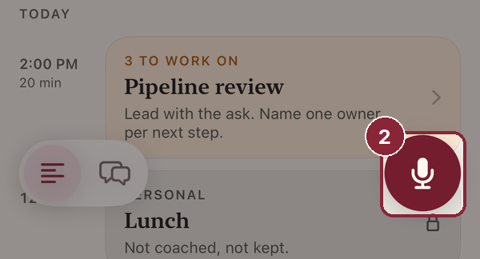
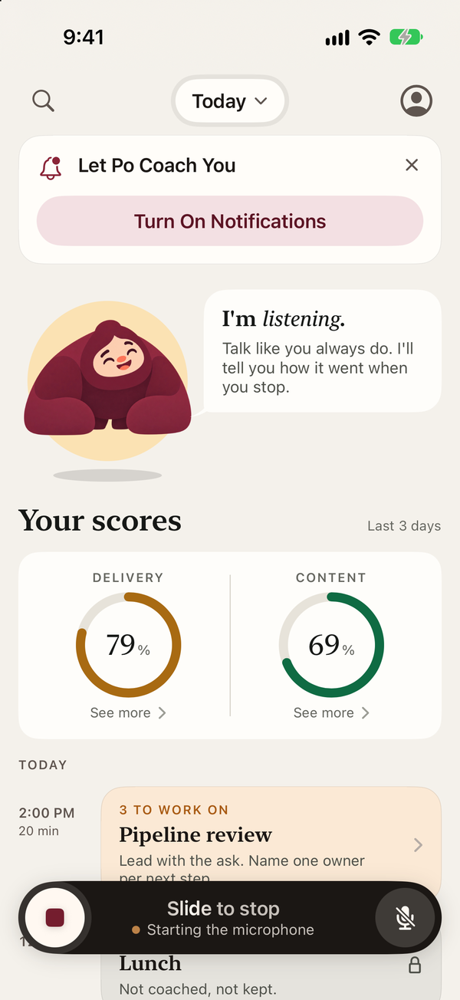
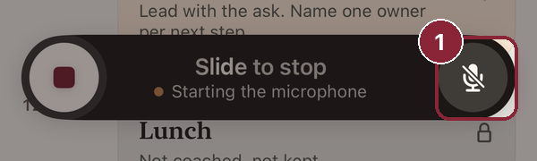
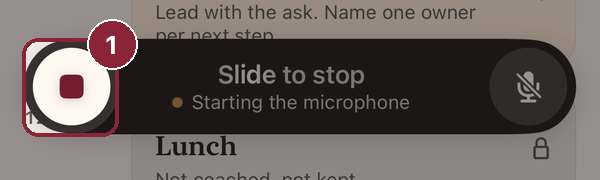

# Recording a Talk

Part 2 · Task Documentation · For: Po users

To get feedback, you record a real conversation: a meeting, a class, a client call, or an interview. Po records only between the moment you start and the moment you stop.

## Before You Start

You need:

- Po set up on your iPhone. See [Setting Up Po](task-set-up-po.md).
- Permission from the people you will record. See [Privacy and Consent](concept-privacy-and-consent.md).

?> **Where to put your iPhone:** Place it face up on the table near you, within arm's reach, or keep it in a shirt pocket. A phone in a bag or a closed drawer may not hear you well.

## To Start Recording

!> Before you record, ask the people in the conversation if it's OK. In some places, recording people without their permission is against the law.

1. Open **Po Speech**.
2. On the **Talks** page, tap the round maroon button with the microphone at the bottom right **(2)**.

   

   The button stretches into a dark bar that says **Slide to stop**. Under it, "Starting the microphone" changes to a small dot and a running clock, and iOS shows an orange dot at the top of the screen. Po's speech bubble says "I'm listening."

   

3. Talk as you normally would. You can lock your iPhone or switch to other apps. Po keeps recording.

## To Mute and Unmute a Recording (Optional)

Mute the recording when you want a private moment, for example a side conversation, without ending the talk.

1. On the right end of the recording bar, tap the microphone with a line through it **(1)**.

   

   The clock line changes to "Muted" with the time. Po hears nothing while muted.
2. To unmute, tap the same button again. Po starts hearing you again.

## To Stop Recording

1. Put your finger on the round knob at the left end of the bar **(1)**.

   

2. Slide the knob all the way to the right. A tap alone doesn't stop the recording; this protects you from stopping by accident. The bar shows "Saving the talk" and "Its feedback comes in a minute or two."

When Po finishes saving, the bar turns back into the round microphone button, and your talk appears at the top of today's list with the status "Waiting for Po." About a minute or two later, its label changes to show what to work on, such as **PRIORITY** or **2 TO WORK ON**.

If nobody spoke during the recording, Po doesn't add a talk.

## To Start or Stop Recording from the Lock Screen

After you have opened Po once, a Po card stays on your Lock Screen. It says **Po is off** and has a switch.

1. Wake your iPhone without unlocking it.
2. On the Po card, turn on the switch. The card changes to **Po is recording** with a timer.
3. To stop, turn off the switch. The card changes back to **Po is off**.

If the card says **Po can't start**, iOS didn't let Po turn on the microphone from the Lock Screen. Unlock your iPhone, open Po, and tap the record button instead.

## Things to Know While Recording

| Situation | What Po does |
|---|---|
| You get a phone call | Po records nothing during the call, then continues the recording when the call ends. |
| The talk goes past 30 minutes | Po closes the talk and starts a new one automatically. Your recording doesn't stop. |
| Nobody talks for 5 minutes | Po splits the recording into two talks. |
| You close Po by swiping it away in the app switcher | The recording ends. Open Po and tap the record button to start again. |
| Night falls during a recording and **Mute at night** is on | The recording mutes itself and unmutes in the morning. Po sends a notification each time. |
| You see **Allow the microphone** instead of the record button | The microphone is off for Po. Tap the bar to open Settings, turn on **Microphone**, and return to Po. |

?> While Po is recording, the **Practice** page is hidden. It comes back when you stop.

## Result

Your talk is saved on your iPhone and appears on the main page. Po writes its feedback within a minute or two.

---

**Next:** [Review the talk's feedback](task-review-a-talk.md).
