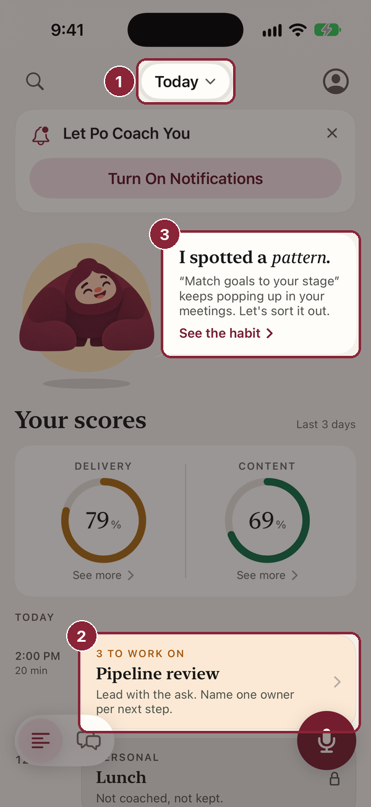
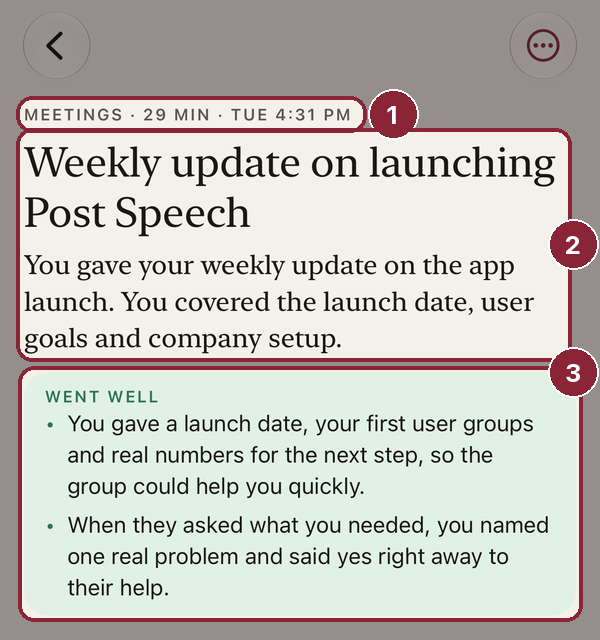
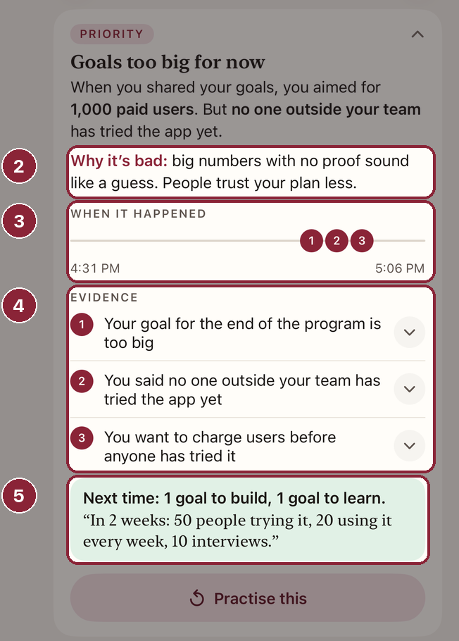
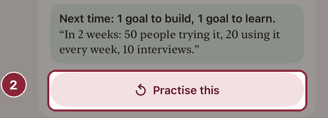

# Reviewing a Talk's Feedback

Part 2 · Task Documentation · For: Po users

After you record a talk, Po shows what went well and what to work on, using moments from your own conversation. This task shows you how to read that feedback and choose one thing to try next time. It takes about 5 minutes per talk.

## Before You Start

You need:

- A talk you recorded at least a few minutes ago. See [Recording a Talk](task-record-a-talk.md).
- To know what coaching cards are. See [Core Concepts](concept-core-concepts.md).

## Reading the Feedback

### To Open a Talk

1. On the **Talks** page, scroll to the day you recorded the talk. To jump to an earlier day, tap the date button at the top of the page **(1)**, such as **Today**, and choose a day in the calendar.
2. Tap the talk **(2)**. The label at the top of each talk tells you how many things it has to work on, such as **3 TO WORK ON**. Start with talks labeled **PRIORITY**, because they have the most important things to fix.

   The talk's page opens. If it says "Po is reading this conversation. It takes a minute or two.", wait a moment; the feedback appears on its own.

**Shortcut:** If Po's speech bubble **(3)** shows **See why**, tap it to open the talk Po thinks needs a look. (When it shows **See the habit**, it opens a habit instead.)

### To Read the Summary

1. At the top of the page, read the line in capitals **(1)**. It tells you the kind of talk Po thinks this was, how many minutes you spoke, and when.
2. Read the title and the one-sentence summary **(2)** to make sure Po understood the conversation.
3. Read the green **WENT WELL** box **(3)**. These are strengths to keep doing.

   

### To Read a Coaching Card

Under **Work on these**, each card is one thing to work on. The most important card comes first, and the number on the right, such as **3 things**, tells you how many there are.

1. Tap the first card. The card opens.

   

2. Read **Why it matters** (or **Why it's bad** on a PRIORITY card) **(2)** to understand how this moment affected your message.
3. Look at **WHEN IT HAPPENED** **(3)**. Each numbered dot on the timeline is one moment in the talk.
4. Under **EVIDENCE** **(4)**, tap a moment to open it. Your words appear in a box labeled **WHAT YOU SAID**, and the words that caused the problem are highlighted in yellow.
5. Read the green **Next time** box **(5)**. It gives one thing to try and an example sentence you can say.
6. To close the card, tap its title again.

## Checking a Moment

### To Hear a Moment

1. Open a moment under **EVIDENCE**.
2. Tap the box with your words. A player opens, showing roughly where the moment happened in the talk, for example "AROUND 4:55".
3. Tap the play button. The moment plays, and each word lights up as you hear it.
4. To close the player, tap the **X**.

### To Tell Po It Misheard You (Optional)

Sometimes Po writes down the wrong word, and the feedback is about something you didn't say.

1. Open the moment.
2. Tap **That's not what I said**.
3. Choose one answer:
   - **I said it correctly — the app misheard me** sends the moment to the Po team to fix. It isn't counted against you.
   - **It came out wrong when I said it** adds the word to your own list to work on. The list stays on your iPhone.
4. Tap **Submit**. Po confirms with "Sent to the Po team" or "Added to your list." Tap **Done**.

## Deciding What to Work On

### To Practice a Moment Right Away (Optional)

1. Open a coaching card.
2. At the bottom of the card, tap **Practise this** **(2)**.

   

   Po prepares a short practice based on that moment. See [Practicing for an Upcoming Talk](task-practice.md).

### To Choose What to Practice

You will improve faster by working on one thing at a time.

1. Read the **Next time** box on the first PRIORITY card.
2. Say the example sentence out loud two or three times.
3. Before your next talk of the same kind, remind yourself of that one suggestion.

## Result

You know what went well in the talk and which one thing to try next time.

---

**Next:** To hear the whole talk or read every word, see [Listening Back and Reading the Transcript](task-listen-and-read.md).
