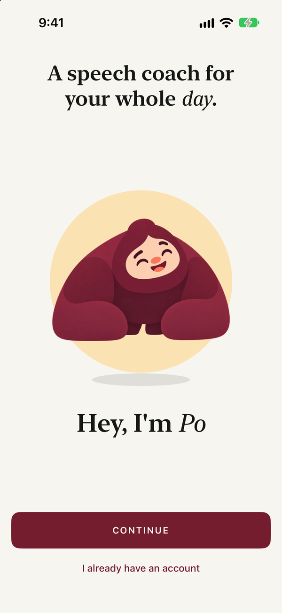
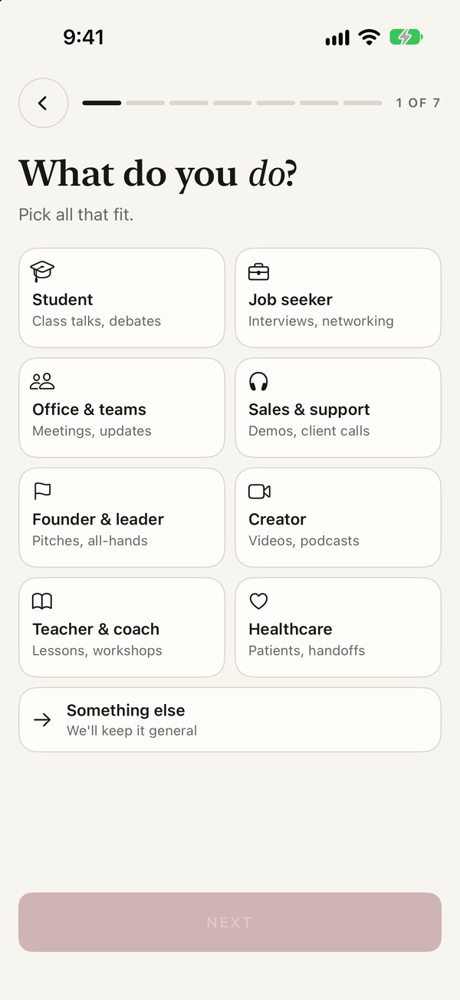
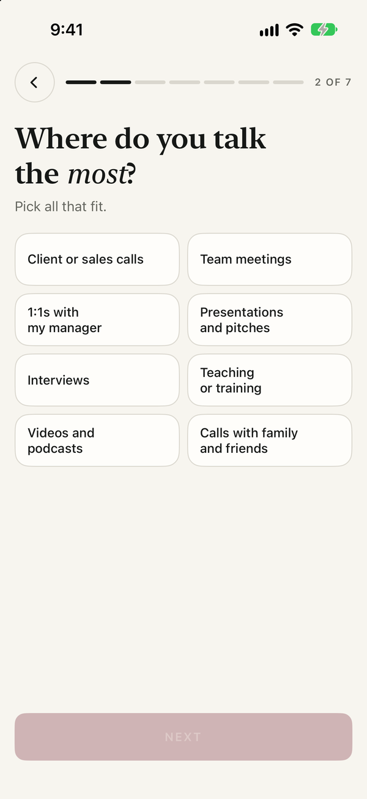
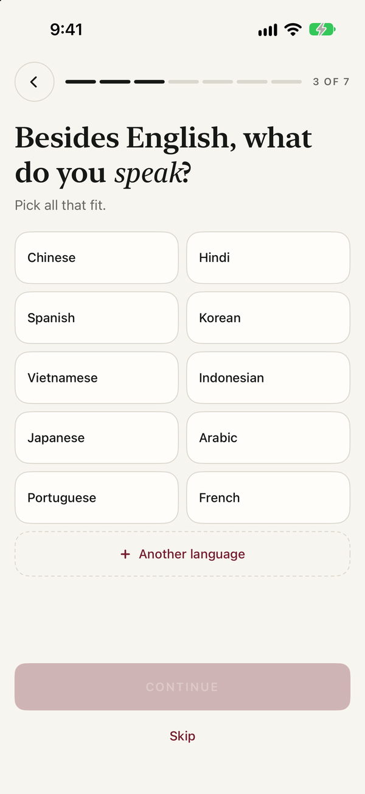
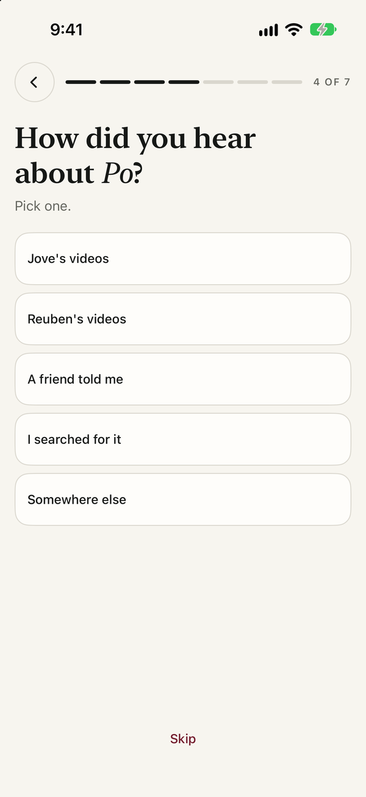
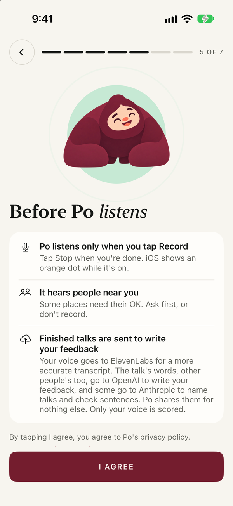
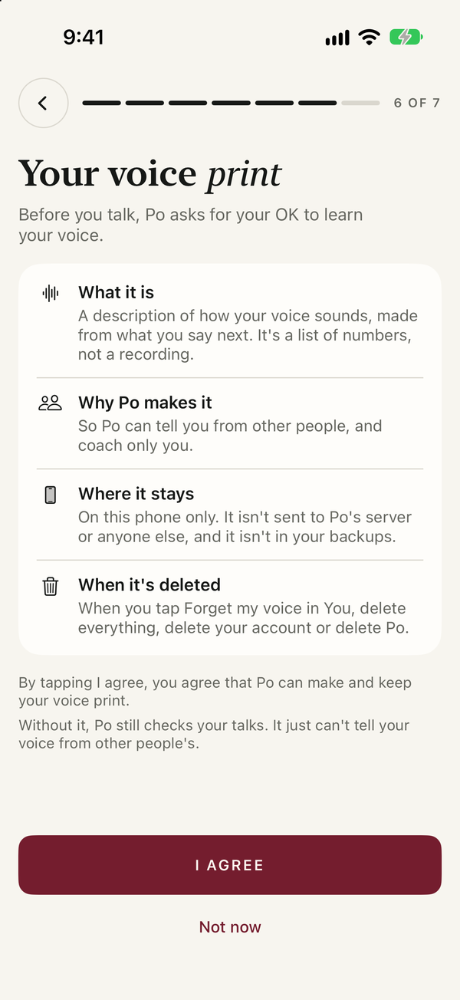
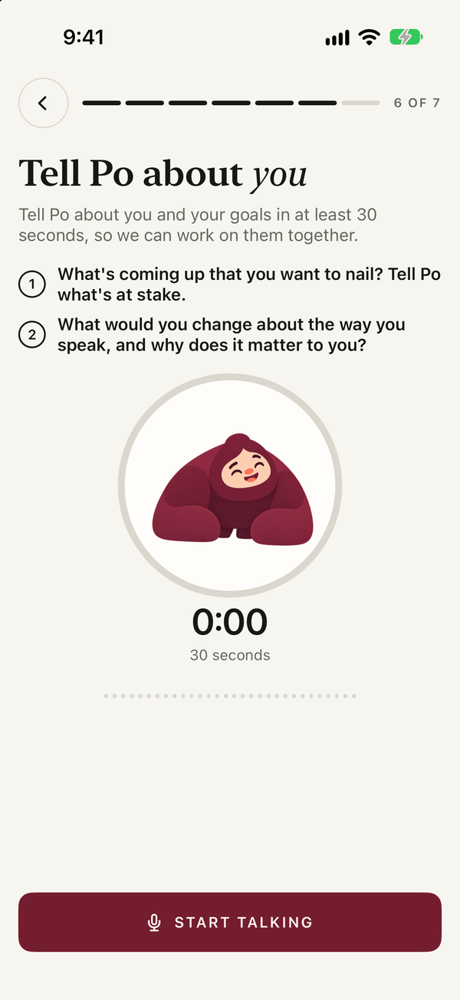
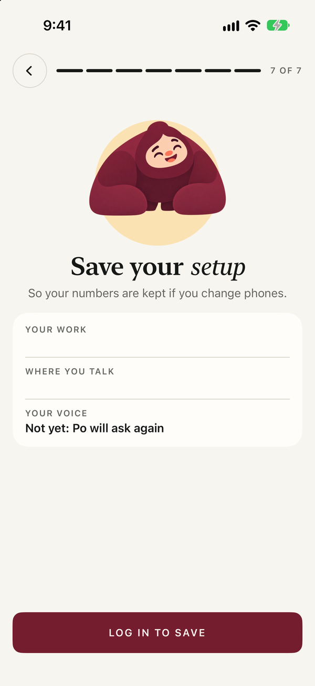

# Setting Up Po

Part 2 · Task Documentation · For: new Po users

The first time you open Po, it walks you through seven short setup steps. You tell Po about your work, agree to how recording works, record a 30-second voice sample, and sign in to save your setup. This task takes about 5 minutes.

## Before You Start

You need:

- Po installed on your iPhone. See [Installing Po from TestFlight](task-install-po.md).
- An internet connection. Po downloads a small file once, during the voice step.
- **A quiet place** where you can talk out loud for about a minute.
- An Apple Account, a Google account, or an email address to sign in with.

?> A counter at the top right of each step, such as **2 OF 7**, shows how far along you are. To go back a step, tap the round **‹** button at the top left. If you leave Po halfway, it reopens at the same step.

## To Start Setup

1. Open **Po Speech** on your iPhone. The welcome page appears.

   

2. Tap **CONTINUE**. iOS asks: "“Po Speech” Would Like to Send You Notifications."
3. Tap **Allow** so Po can tell you when your feedback is ready. You can change this later. If you tap **Don't Allow**, setup continues normally.

If you already have a Po account from another phone, tap **I already have an account** on the welcome page instead, and sign in. If your account has finished setup before, Po skips the rest of setup.

## To Tell Po About Your Work

Po uses your answers to choose what to coach you on. You can change them later on the You page.

1. On **What do you do?**, tap every card that fits you, such as **Student** or **Office & teams**. A chosen card turns dark maroon with a tick.

   

2. Tap **NEXT**. The button stays faded until you choose at least one card.
3. On **Where do you talk the most?**, tap every place that fits, such as **Team meetings** or **Interviews**.

   

4. Tap **NEXT**.
5. On **Besides English, what do you speak?**, check the languages Po has already chosen from your iPhone's settings. Tap a language to add or remove it. You can choose up to 5.

   

   - To find a language that isn't shown, tap **+ Another language**, search for it, and tap **Done**.

6. Tap **CONTINUE**, or tap **Skip** if you speak only English.
7. On **How did you hear about Po?**, tap your answer, or tap **Skip**. The next step opens by itself.

   

## To Agree to How Po Records

!> Read this page carefully. It explains that Po hears everyone near you, and that some places require their permission. See [Privacy and Consent](concept-privacy-and-consent.md).

1. On **Before Po listens**, read the three points.

   

2. Optional: To read the full policy, tap **Read the privacy policy ›**, then swipe the policy down to close it.
3. Tap **I AGREE**.

## To Teach Po Your Voice

In this step you talk about yourself for at least 30 seconds. Po learns what your voice sounds like, so it can score only you and not the people you talk with. First, Po asks for your OK to make a *voice print*: a description of how your voice sounds that stays on your iPhone.

!> Do this step somewhere quiet, at your normal speaking volume. Background voices or noise can stop Po from learning your voice.

1. On **Your voice print**, read what Po will make and where it stays.

   

2. Tap **I AGREE**. The **Tell Po about you** page opens.

   If you tap **Not now** instead, Po skips your voice for now. Po still checks your talks, but it can't tell your voice from other people's until you set it up later.

3. On **Tell Po about you**, wait until the **START TALKING** button turns dark. While Po downloads what it needs, the page shows "Getting Po ready to hear you" and a progress bar.

   

4. Tap **START TALKING**. If iOS asks to let Po Speech use the microphone, tap **Allow**. A ring around Po starts to fill and a timer counts up.
5. Talk naturally about the two questions on the screen: what's coming up that you want to do well, and what you would change about the way you speak. Silences don't count toward the 30 seconds, so take your time. When you have talked enough, the ring turns green and shows **enough**.
6. Finish your sentence, then tap **CONTINUE**. Po learns your voice, and the last step opens by itself.

### If the Voice Step Doesn't Work

| You see | What to do |
|---|---|
| "That wasn't clear enough for Po to learn your voice." | Move somewhere quieter and tap **TRY AGAIN**. |
| "Po needs the microphone to hear you." | Tap **OPEN SETTINGS**, turn on **Microphone** for Po Speech, then return to Po. |
| "Po needs the internet for a moment" or "Po couldn't get ready" | Connect to Wi-Fi and wait, or tap **Continue for now** and teach Po your voice later from the main page. |

## To Save Your Setup

1. On **Save your setup**, check the summary of your work, where you talk, and your voice.

   

2. Tap **LOG IN TO SAVE**. A sign-in window opens.
3. Choose how to sign in, with Apple, with Google, or with your email address, and follow the prompts. If you choose email, Po sends you a code to type in.

   When you are signed in, the window closes, setup finishes, and Po's main page opens. A short tour of the main page starts over it.

## To Take the Tour

The tour has 8 short cards that point to the main parts of the page.

1. Read each card, then tap the **›** arrow, or tap the part of the page the card points to.
2. On the last card, tap **Start using Po**.

You can skip the tour at any time by tapping **Skip**. To see it again later, tap the person icon at the top right of the main page, then tap **How Po works**.

## Result

Po is set up. The main page shows "Nothing yet today" until you record your first talk.

---

**Next:** [Record a talk](task-record-a-talk.md).
